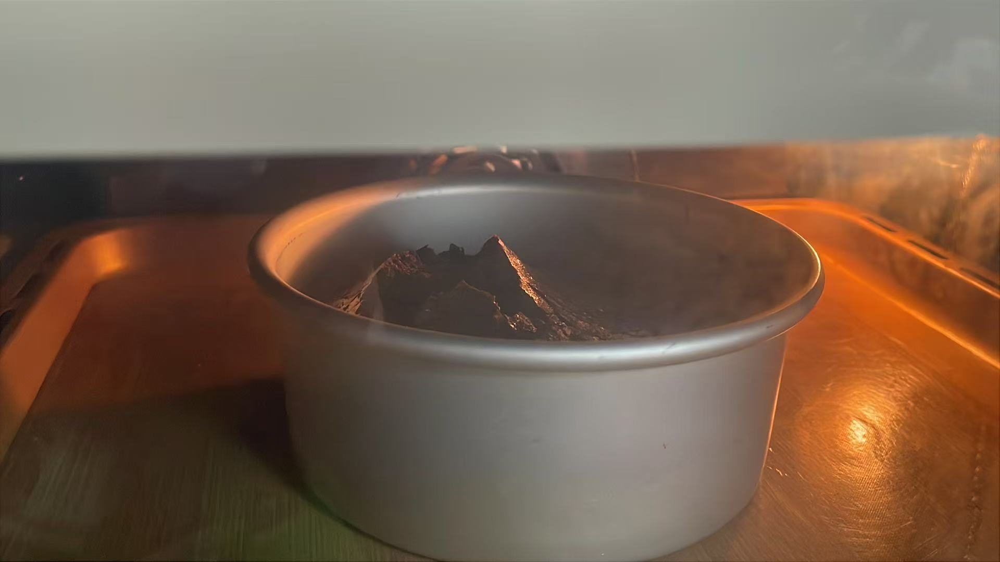

# 巧克力九重奏 · Chocolate Nonet Cake

一个基于纯 HTML / CSS / JavaScript 的**交互式烘焙教程网页**，用动画一步步演示 6 寸十四层巧克力蛋糕的完整制作过程。



## 项目简介

「巧克力九重奏」是一个由布朗尼、戚风、白巧克力奶油、慕斯、奶冻、黄油薄脆等组成的十四层复合蛋糕。本项目将整个制作流程拆解为 27 个步骤，用 SVG 动画还原每一步的操作，包括原料飞入、融化搅拌、打发蛋白、烘烤倒扣、逐层组装等。左侧是同步的中英文食谱，右侧是操作提示，顶部原料栏会实时扣减库存，让观看者像在真实厨房里一样跟随步骤完成烘焙。

无需任何构建工具，打开 `index.html` 即可运行。

## 功能特点

- **27 步交互式流程**：按「下一步」逐步推进，每一步都有对应动画与食谱
- **原料自动扣减**：顶部原料栏显示剩余用量，使用后自动减少
- **中英双语**：所有步骤、提示、配料均为双语，适合教学与展示
- **SVG 手绘动画**：融化、筛粉、打发、倒扣、组装均为矢量动画，清晰不模糊
- **响应式布局**：适配桌面与移动端，手机竖屏自动切换为上下布局
- **成品展示页**：最后两页展示 8 张实拍成品照片，带弹入与旋转效果

## 技术栈

- 纯 HTML5 + CSS3 + 原生 JavaScript
- SVG 矢量图形与 CSS Keyframes 动画
- 无第三方依赖、无构建步骤

## 本地运行

```bash
# 克隆仓库
git clone https://github.com/你的用户名/Chocolate-Nonet-Cake.git

# 进入目录
cd Chocolate-Nonet-Cake

# 方式一：直接双击 index.html 打开
# 方式二：启动本地服务器（推荐，避免图片加载问题）
python3 -m http.server 8000
# 然后浏览器访问 http://localhost:8000